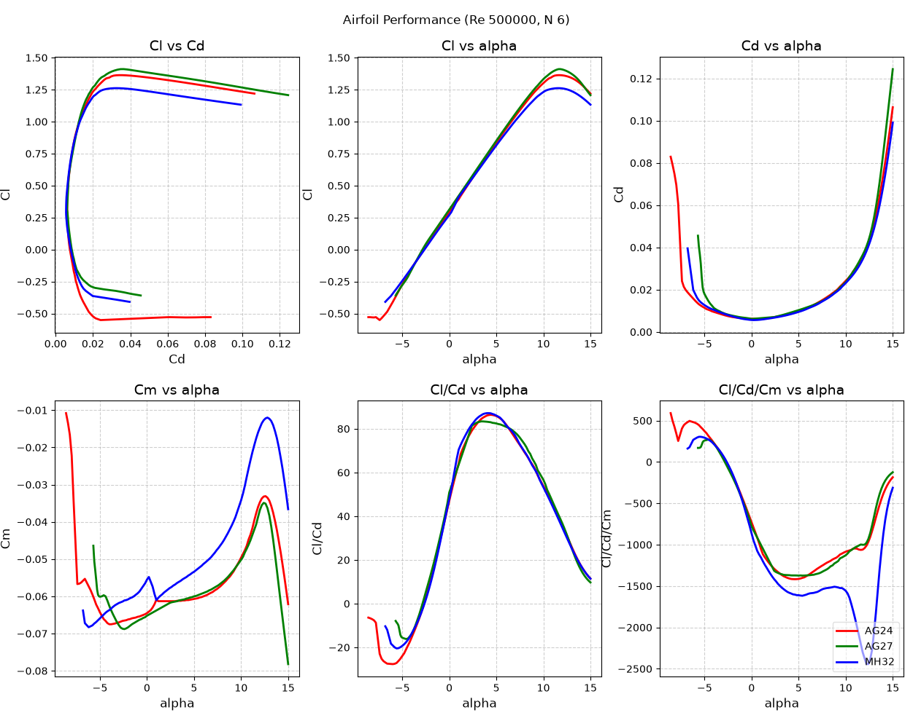
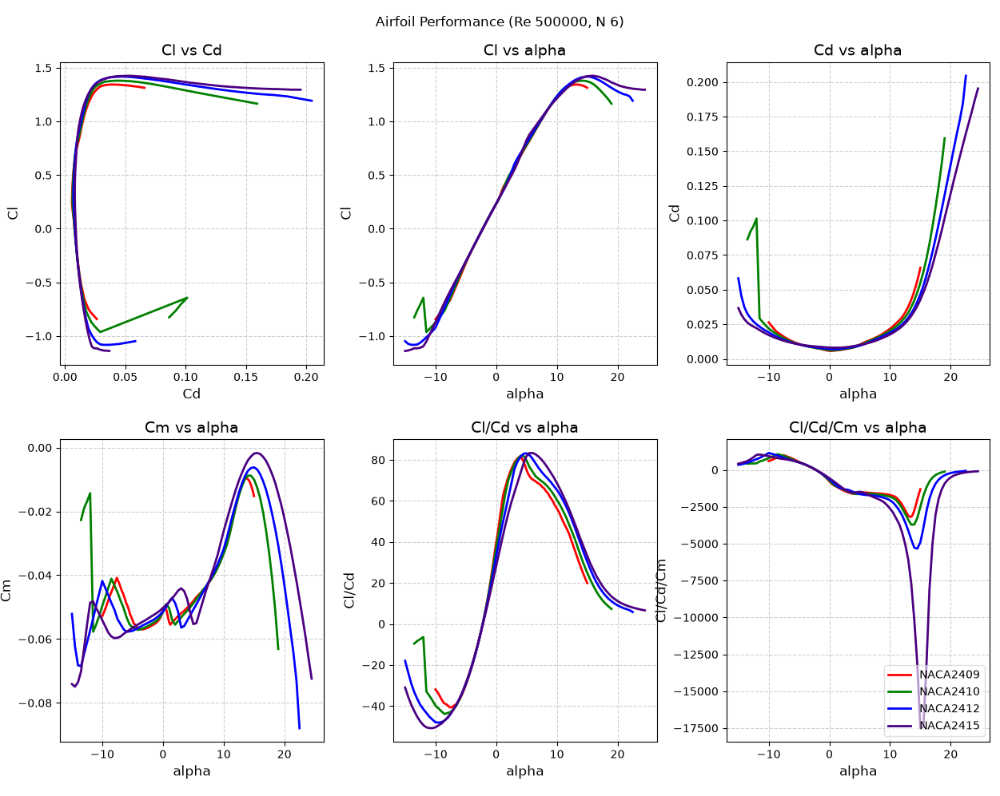
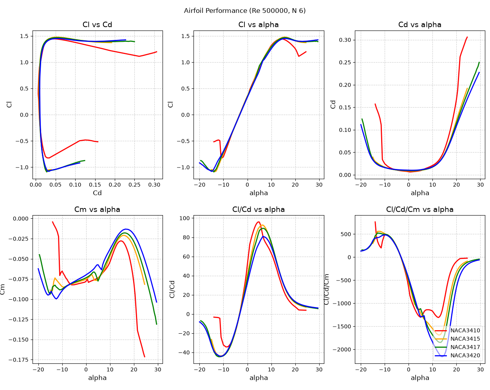
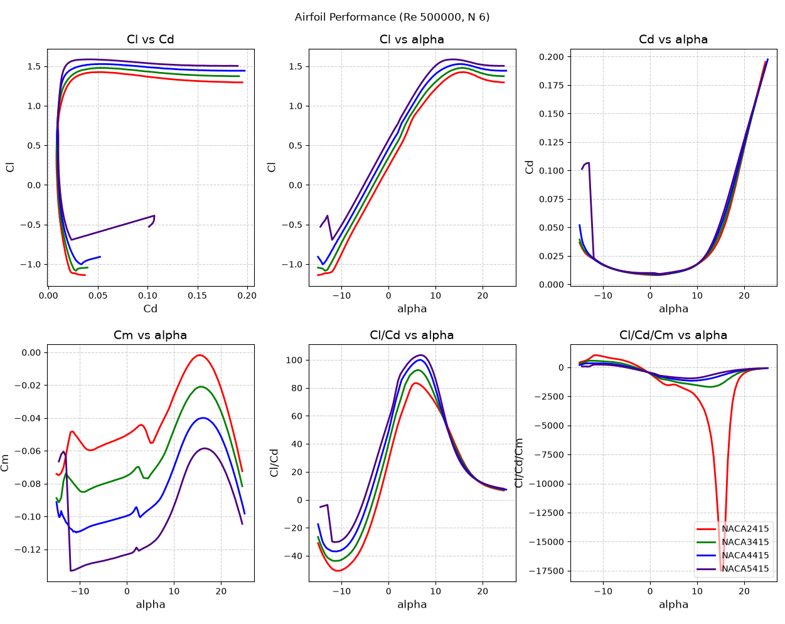

First, I looked at modern high performance foils. These were difficult to converge in xfoil, so they have reduced AOA range.

NACA 24xx series airfoils are meant to be efficient, however, I want to prioritize small wing size. NACA foils seem to generate lift over a larger range of AOA than the specialized ones.

Naca 34xx series airfoils provide better lift, and more efficiency over the 24xx. Howver, it has increased pitching moment, which creates its own instability and losses.

I compared NACA 2 to 5 series foils at 15% thickness, to see the difference in pitching moment and efficiency.

Overall, I think NACA 3410 is a good tradeoff, but if more space is required, it could bump up to 3415.

Airfoils from:
https://m-selig.ae.illinois.edu/ads/coord_database.html

Plots generated by:
https://web.mit.edu/drela/Public/web/xfoil/